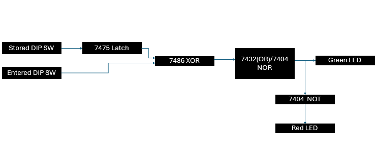
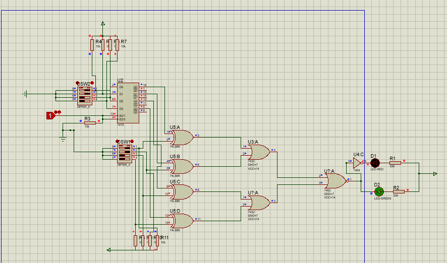
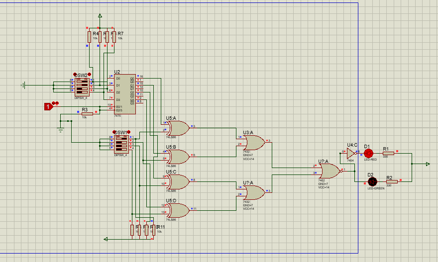
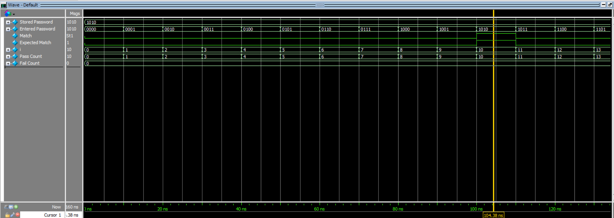
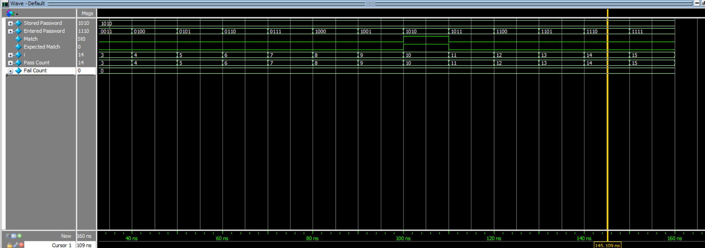

**4-Bit Combinational Password Lock Using Discrete 74-Series Logic**

A gate-level password verification system implemented and verified in 

both Proteus (schematic simulation) and Verilog (ModelSim). All 16 input 

combinations are tested with a self-checking testbench.

#### **Overview**

The design compares a 4-bit "entered password" against a 4-bit "stored 

password" and asserts a `match` signal only when they are identical.

**Stored password** is latched using a 7475 D-latch (Proteus)/edge-triggered flip-flop (RTL Verilog).

**Bit-wise comparison** uses 7486 XOR gates.

**Match detection** uses 7402 NOR gates + 7432 OR gate.

**"Green LED"** = match, "**Red LED"** = no match.

* ##### **Block Diagram**

\---

* ###### **Proteus Implementation**

**Match Case** (Green LED ON)

**No-Match Case** (Red LED ON)

* ###### **Verilog Implementation**

**Gate-Level Design**

\- [Password\_Lock.v](Verilog/Gate_Level/Gate_Level.v)

**Testbench**

\- [tb/Password\_Lock.v](Verilog/Testbench/Test_bench.v)

* ###### **Verification Methodology**

The testbench is **self-checking**: it independently computes the 

expected output and compares it against the DUT's actual output.

* ###### **What the testbench does:**

1\. Sets the stored password to a fixed value (`1010`).

2\. Loops through all 16 possible entered passwords (`0000` to `1111`).

3\. For each case, computes `expected\_match` independently:

&#x20;  `expected\_match = (stored\_pw == entered\_pw) ? 1 : 0`

4\. Compares `match` (design output) against `expected\_match`.

5\. Counts PASS/FAIL and prints a summary.

* ###### **Proof of Correctness**

All 16 combinations are tested.

`match = 1` occurs \*\*only\*\* at `entered\_pw = 1010`.

The waveform below visually confirms this behavior.

Full log is available in `simulation\_output.txt`.

* ###### **Simulation Results**

